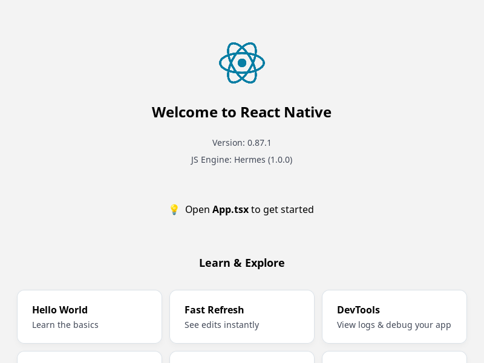

# React Native for Linux (GTK4)

Build native Linux desktop apps with React Native, rendered with GTK4.

[](LICENSE)
[](https://www.npmjs.com/package/@curiosity26/react-native-gtk4)
[](https://github.com/curiosity26/react-native-gtk4/actions/workflows/js.yml)
[](https://github.com/curiosity26/react-native-gtk4/pulls)

> See the official [React Native website](https://reactnative.dev/) for an
> introduction to React Native.

[React Native](https://reactnative.dev) is a framework for building native
apps with React. **React Native for Linux** brings it to the Linux desktop
on [GTK4](https://www.gtk.org), the way
[react-native-windows](https://github.com/microsoft/react-native-windows)
and [react-native-macos](https://github.com/microsoft/react-native-macos)
bring it to Windows and macOS: an out-of-tree platform you add to an
existing React Native app, sharing its JavaScript with iOS, Android,
Windows and macOS.

It runs React Native's New Architecture (Fabric, TurboModules, Hermes)
in a C++ host that talks to GTK directly: views draw with GSK, text is
laid out with Pango, and inputs, switches, menus, dialogs and file
choosers are GTK's own, so apps follow the desktop's theme, dark mode and
accessibility (Orca).



## Quick links

- [Getting started](docs/getting-started.md)
- [Components](docs/components.md) and [APIs](docs/apis.md)
- [Community libraries](docs/libraries.md)
- [Native modules and components](docs/native-modules.md)
- [Packaging apps](docs/packaging.md): Flatpak, .deb, .rpm
- [Upgrading React Native](docs/upgrading.md)
- [Architecture](docs/architecture.md) and [roadmap](docs/roadmap.md)

## Requirements

- **A GNOME-based desktop with GTK 4.14 or newer**, on X11 or Wayland:
  - Ubuntu 24.04 and Linux Mint 22 (Cinnamon)
  - Debian 13
  - Fedora 44 and 45
  - Enterprise Linux 10 (RHEL, CentOS Stream, AlmaLinux, Rocky Linux)

  x86_64 and aarch64. Other distributions with GTK 4.14 build from source.
  KDE is out of scope.
- **Node.js 22.13 or newer.**
- **clang, CMake and Ninja**, plus GTK's and libsoup's development
  packages. `run-linux` checks for them and prints the install command for
  your distribution; see [getting started](docs/getting-started.md#prerequisites).

## Getting started

Add Linux to a React Native app:

```sh
npx @react-native-community/cli@20.2.0 init MyApp --version 0.87.1
cd MyApp
npm install @curiosity26/react-native-gtk4
npx react-native init-linux      # adds linux/, Metro's linux platform, "npm run linux"
npx react-native run-linux       # builds, starts Metro, opens the window
```

On the distributions above, `run-linux` downloads a prebuilt host library,
so the first build takes seconds. Elsewhere it builds React Native's C++
core and Hermes once into `~/.cache/react-native-gtk4`, shared by all your
apps. `run-linux --release` makes a self-contained build, and
`package-linux` turns it into a Flatpak, .deb or .rpm.

Apps bundle for their own `linux` platform: `Platform.OS === 'linux'` and
`.linux.js` files. In development they load from Metro with fast refresh,
LogBox and React Native DevTools.

Full walkthrough: [docs/getting-started.md](docs/getting-started.md).

## React Native versions

Each React Native minor version has its own line. The package's version is
React Native's major.minor plus a patch of its own, and each line has a
`v<major>.<minor>-stable` dist-tag:

| React Native | Package | Install |
| --- | --- | --- |
| 0.87 | 0.87.x | `npm install @curiosity26/react-native-gtk4` (`latest`) |
| 0.86 | 0.86.x | `npm install @curiosity26/react-native-gtk4@v0.86-stable` |
| 0.85 | 0.85.x | `npm install @curiosity26/react-native-gtk4@v0.85-stable` |
| 0.84 | 0.84.x | `npm install @curiosity26/react-native-gtk4@v0.84-stable` |
| 0.83 | 0.83.x | `npm install @curiosity26/react-native-gtk4@v0.83-stable` |

`main` tracks the newest React Native; older lines live on `release/0.83`
to `release/0.86`. Reanimated and Worklets need React Native 0.86 or newer.

## Community libraries

Libraries with JavaScript only work as they are. For popular libraries
with native code, this repository has Linux ports in
[packages/](packages); install the port next to the library and
`run-linux` autolinks it:

| Library | Linux package |
| --- | --- |
| @react-native-async-storage/async-storage | `@curiosity26/react-native-gtk4-async-storage` |
| @react-native-community/netinfo | `@curiosity26/react-native-gtk4-netinfo` |
| react-native-safe-area-context | `@curiosity26/react-native-gtk4-safe-area-context` |
| react-native-gesture-handler | `@curiosity26/react-native-gtk4-gesture-handler` |
| react-native-screens | `@curiosity26/react-native-gtk4-screens` |
| react-native-worklets | `@curiosity26/react-native-gtk4-worklets` |
| react-native-reanimated | `@curiosity26/react-native-gtk4-reanimated` |
| react-native-svg | `@curiosity26/react-native-gtk4-svg` |
| react-native-webview | `@curiosity26/react-native-gtk4-webview` |
| react-native-vector-icons | `@curiosity26/react-native-gtk4-vector-icons` |

What each port covers, and React Navigation on Linux:
[docs/libraries.md](docs/libraries.md).

## Contributing

The repository's own host, `rn-gtk-host`, runs the example app in
`examples/hello-world` (the Showcase) and the self-tests:

```sh
npm run start:hello-world   # terminal 1: Metro
npm run dev:showcase        # terminal 2: the Showcase; Ctrl+R reloads, Ctrl+D dev menu
npm test                    # CLI, Metro config and release script tests
scripts/test-new-app.sh     # end to end: new apps from the npm tarball
```

Building React Native from source: [docs/building-react-native.md](docs/building-react-native.md).
How releases are cut and published: [docs/releasing.md](docs/releasing.md).
Issues and pull requests are welcome on
[GitHub](https://github.com/curiosity26/react-native-gtk4/issues).

## License

React Native for Linux is [MIT licensed](LICENSE).
